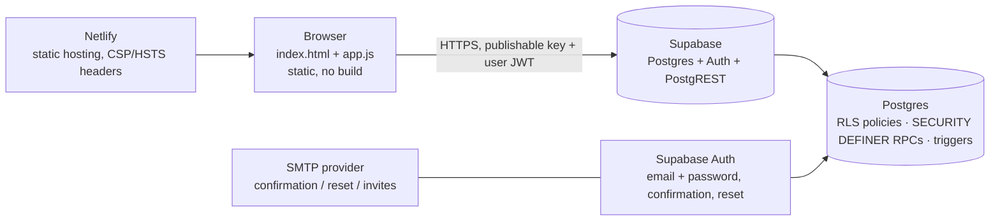
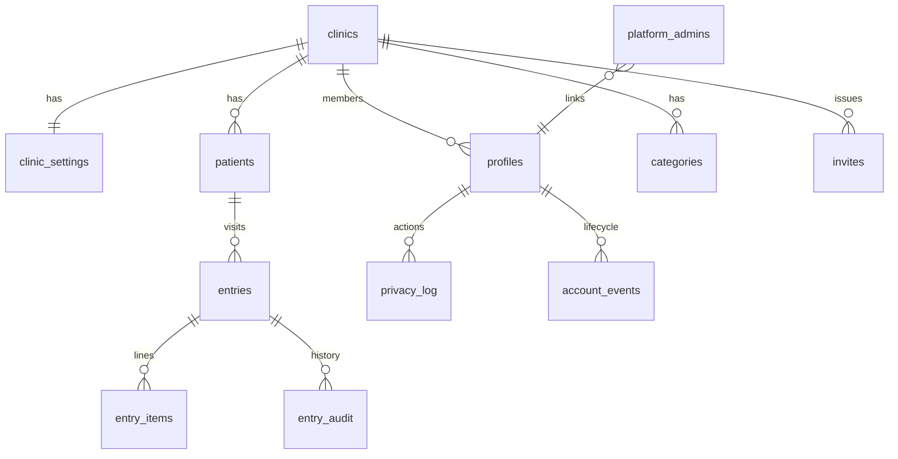

# Praxia · Registro — Architecture

_Last updated: 19 Oct 2026. Audience: engineers joining the project and technical due diligence._

## 1. What it is

A multi-tenant revenue ledger for private medical practices (Tijuana, MX). Each **clinic** is a tenant; each **user** belongs to one clinic with a role (`manager` or `recepcion`). **Platform admins** (the Praxia team) manage clinics and accounts but never see clinics' patient or revenue data.

## 2. System

- **Front end:** static HTML/CSS/JS served by Netlify. No framework, no bundler. `app.js` talks to Supabase with `supabase-js` (pinned, SRI-checked) using the **publishable** key; the user's JWT carries identity.
- **Backend:** Supabase. All authorization is in Postgres: row-level security isolates tenants; writes to money records and all account/membership changes go through `SECURITY DEFINER` functions (RPCs) that enforce permissions server-side. The browser cannot bypass them.
- **Auth:** Supabase Auth. Sign-up stores the clinic name / invite code in user metadata; database triggers finish the sign-up when the email is confirmed (`0006_accounts.sql`).
- **Why no application server (yet):** every rule the product needs today is expressible in SQL/PL/pgSQL with RLS, which is both the simplest and the most auditable place for it. When server-side jobs are needed (email invites via the admin API, PDF receipts, scheduled cleanups, billing webhooks) they go in **Supabase Edge Functions** (TypeScript), same language as the front end. A separate Java/Node service is not planned; see `docs/ROADMAP-ROBUSTEZ.md`.

## 3. Repository layout

| Path | Purpose |
|---|---|
| `index.html`, `app.js`, `app.css` | The application (markup, logic, styles) |
| `config.js` | Environment selection (production / development) and app version |
| `legal-config.js`, `privacidad.html`, `terminos.html`, `aviso-pacientes.html`, `legal.css/js` | Legal documents (LFPDPPP) |
| `fonts/` | Self-hosted fonts (no third-party requests) |
| `0001_…sql` … `0007_…sql` | Database migrations, applied in order (never edited after they run) |
| `netlify.toml` | Publish directory and security headers (CSP, HSTS, …) |
| `tests/sql/` | SQL scenario tests with assertions (RLS, permissions, lifecycle) |
| `tests/e2e/` | Playwright tests of the UI against a fake Supabase API, with the real CSP |
| `scripts/` | `test-sql.sh`, `check-html.js`, `db/apply.sh`, `db/backup.sh` |
| `.github/workflows/ci.yml` | CI: lint, HTML sanity, SQL tests on Postgres 16, browser tests |
| `docs/` | Plans and procedures (legal, accounts, incidents, this file, roadmap) |

## 4. Data model (public schema)

- `profiles.status`: `pending_email → needs_clinic → active → disabled`; `clinics.status`: `active | suspended`. `current_clinic_id()` returns a clinic only for an active member of an active clinic, so every policy inherits those states.
- Money: `entries` (visit) + `entry_items` (lines with their own payment method and currency); the USD→MXN rate is frozen per entry (`entries.fx_rate`). Written only through `save_entry()` (one transaction).
- Audit: `entry_audit` (every change to money rows), `privacy_log` (consents, anonymizations, deletions), `account_events` (every sign-up step, membership change), `client_errors` (uncaught browser errors).

## 5. Security model

| Layer | Control |
|---|---|
| Transport | HTTPS only; HSTS; CSP with no inline scripts; scripts only from the site and the SRI-pinned CDN; API calls only to our Supabase project; no framing |
| Identity | Supabase Auth; email confirmation; 10-character minimum; password reset; 30-minute idle logout |
| Authorization | RLS on every table (tenant = `current_clinic_id()`); capability flags for reception (`has_cap()`); manager/owner/admin guards inside RPCs; internal functions revoked from API roles |
| Admins | `platform_admins` (added only in the SQL editor); `is_platform_admin()`; admin RPCs cover accounts and clinics, not clinic data |
| Data protection | LFPDPPP: consent record, ARCO self-service, anonymization that keeps fiscal records, clinic/account deletion, privacy notices (`docs/PLAN-LEGAL-MX.md`) |
| Secrets | Only the publishable key is in the repo. The `service_role` key never leaves Supabase (future Edge Functions read it from Supabase secrets) |

## 6. Environments and deployment

- **Production:** `main` → Netlify production deploy (automatic). Database: the production Supabase project.
- **Previews:** every pull request → Netlify Deploy Preview. `config.js` points previews and `localhost` to the **development** Supabase project once its URL/key are filled in; until then they use production (a console notice says so).
- **Migrations:** numbered `.sql` files at the repo root, applied in order with `scripts/db/apply.sh "<DATABASE_URL>" <first-pending>` or by pasting into the SQL editor. CI applies all of them to a fresh Postgres on every PR, so a migration that doesn't run cleanly cannot be merged.
- **Backups:** Supabase Pro (daily) or `scripts/db/backup.sh` (weekly, stored off-platform).

## 7. Quality gates

`npm run check` = `eslint` + `scripts/check-html.js` + SQL tests (`tests/sql`, run against all migrations) + browser tests (`tests/e2e`). The same runs in GitHub Actions on every push and pull request. Protect `main` so the CI check is required.

## 8. Known limits (see roadmap)

- One clinic per user (by decision; the schema does not preclude a membership table later).
- The front end downloads a clinic's whole ledger per screen (paged in batches of 1,000). Fine for tens of thousands of rows; date-range loading and server-side totals are the next step.
- No offline mode; a lost connection during save shows an error and keeps the form.
- Email delivery depends on the clinic's SMTP configuration in Supabase.
