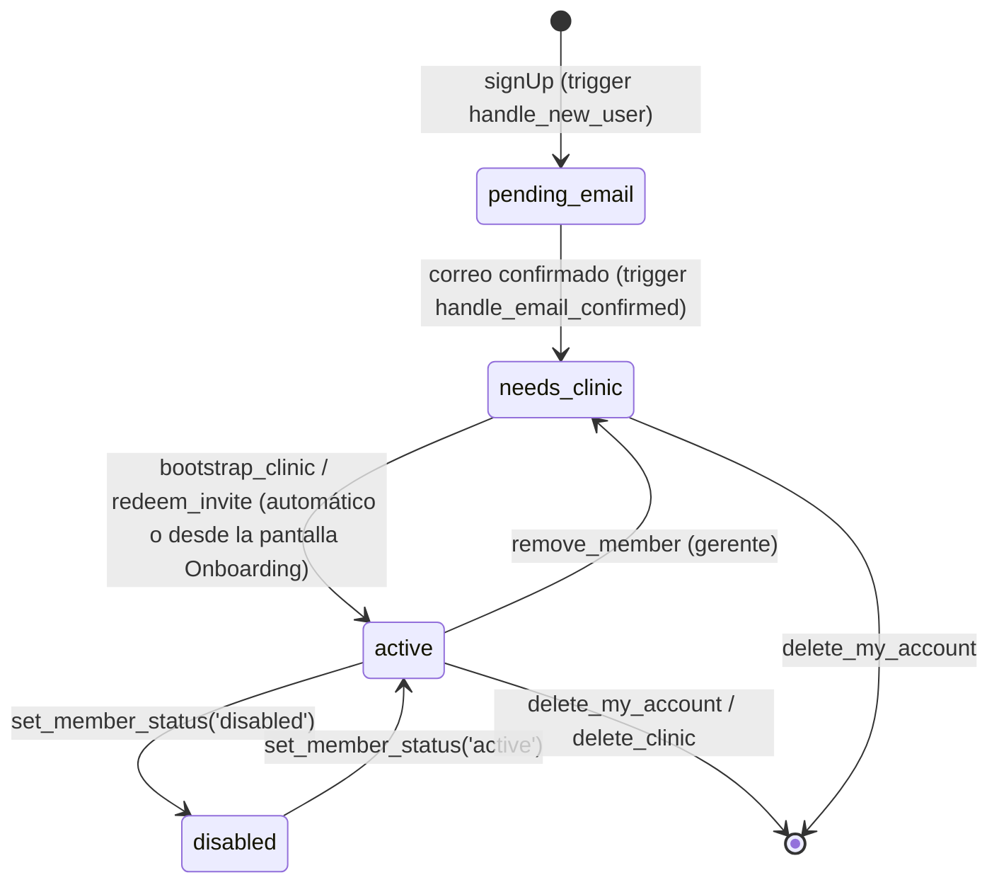
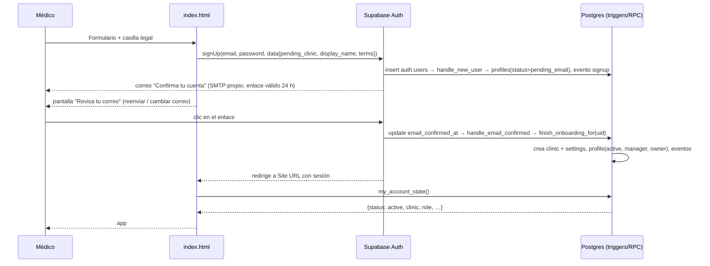

# Plan: creación de cuentas robusta y almacenamiento de datos de cuenta

_Fecha: 18 de octubre de 2026 · Base: `main` en `249c2d1` (migraciones `0001`–`0005`)._

> **Resumen.** El alta de cuentas falla hoy por dos causas verificadas (una de configuración, una de permisos) y por un diseño en el que el navegador es quien "termina" el alta después de confirmar el correo. El plan cambia eso: **el servidor es dueño del ciclo de vida de la cuenta**, cada estado tiene una pantalla y una salida, todo queda registrado, y el flujo completo se prueba con correos reales en local antes de tocar producción. Son 6 fases; la fase 0 (solo configuración) y la fase 1 (hotfix) destraban producción en uno o dos días.

---

## 1. Diagnóstico del flujo actual

### 1.1 Cómo funciona hoy

1. El formulario llama `sb.auth.signUp({ email, password, options: { emailRedirectTo, data: { pending_clinic | pending_invite, display_name, terms_version… } } })`.
2. El trigger `handle_new_user` (en `auth.users`) crea la fila en `profiles` con `role = 'recepcion'` y `clinic_id = NULL`.
3. Con *Confirm email* activado no hay sesión; la app muestra «Te enviamos un correo».
4. El usuario abre el enlace, vuelve a `index.html` con sesión, y `initApp()` lee su perfil; si ve `pending_clinic` llama `bootstrap_clinic()`, si ve `pending_invite` llama `accept_invite()`, y luego borra esos metadatos.

### 1.2 Fallas encontradas

| # | Falla | Efecto | Evidencia |
|---|---|---|---|
| **F1** | El correo integrado de Supabase **solo entrega a correos del equipo del proyecto** y máximo **2 por hora**; es para desarrollo. | Ningún médico real recibe el correo de confirmación. El alta muere en el paso 3. | [Docs: custom SMTP](https://supabase.com/docs/guides/auth/auth-smtp), [rate limits](https://supabase.com/docs/guides/auth/rate-limits) |
| **F2** | La política `profile_read` es `clinic_id = current_clinic_id()`. Para un usuario recién confirmado ambos lados son NULL → **0 filas**. `.single()` devuelve error (`PGRST116`), `pe` queda definido, y la condición `if(!pe && prof && !prof.clinic_id)` que debería crear el consultorio **nunca se cumple**. | Aun con correo funcionando, después de confirmar el usuario ve «Tu cuenta aún no tiene consultorio» y no hay salida. Pasa **siempre** con confirmación activa. | Reproducido en PostgreSQL local con `0001`–`0005`: la consulta devuelve 0 filas; `bootstrap_clinic()` llamada directamente sí funciona. |
| **F3** | `updateUser({ pending_clinic: null, pending_invite: null })` se ejecuta **antes** de comprobar si `bootstrap_clinic`/`accept_invite` tuvo éxito. | Si falla (nombre inválido, código vencido, red), el nombre del consultorio o el código se pierden para siempre. Usuario huérfano. | `index.html`, `initApp()` |
| **F4** | No existe pantalla para un usuario con sesión y sin consultorio. | Solo un mensaje de error; no puede crear consultorio ni meter un código. | `index.html` |
| **F5** | `emailRedirectTo` tiene que estar en *Redirect URLs* de Supabase; si no, el enlace manda al *Site URL* (por defecto `http://localhost:3000`). | El enlace del correo lleva a una página en blanco. | Config de Supabase Auth |
| **F6** | Con confirmación activa, `signUp` con un correo **ya registrado** devuelve éxito con `user.identities = []` en vez de error (protección contra enumeración). | El usuario ve «te enviamos un correo» y nunca llega nada. | [Discusión Supabase #4105](https://github.com/orgs/supabase/discussions/4105) |
| **F7** | Los códigos de invitación vencen a las **48 h** (`0004`); el enlace de confirmación vence a la **1 h** por defecto. La confirmación puede tardar más que ambos. | Código/enlace vencido al confirmar → F3 → huérfano. No se pueden revocar códigos; no hay baja de miembros ni cambio de rol. | `0004_security_fixes.sql`; Auth → *Email OTP expiration* |
| **F8** | No hay registro de en qué paso se quedó cada alta. | «No funciona» es indiagnosticable sin entrar a la base. | — |
| **F9** | No hay «reenviar correo de confirmación» ni «cambiar correo». | El usuario con correo mal escrito o enlace vencido no tiene recurso. | `index.html` |
| **F10** | El trigger de alta no es defensivo: un error dentro de `handle_new_user` haría fallar el `signUp` entero. | Riesgo latente al añadir lógica al trigger. | `0001_init.sql` |

---

## 2. Diseño objetivo

### 2.1 Principios

1. **El servidor termina el alta.** Confirmar el correo dispara en la base de datos la creación del consultorio o el canje de la invitación. El navegador solo informa y ofrece reintentar.
2. **Todo estado tiene pantalla y salida.** Nadie puede quedar en un estado sin botón.
3. **Idempotencia.** Cualquier paso se puede repetir sin duplicar consultorios, perfiles ni invitaciones.
4. **Observabilidad.** Cada paso deja un evento consultable por el gerente y por los socios.
5. **Probado con correos reales** en el stack local de Supabase antes de producción.

### 2.2 Máquina de estados de una cuenta



`current_clinic_id()` devolverá NULL salvo que `status = 'active'`, de modo que **todas** las políticas RLS existentes bloquean automáticamente a usuarios deshabilitados o sin consultorio, sin tocarlas una por una.

### 2.3 Modelo de datos (migración `0006_accounts.sql`)

**`profiles`** (una fila por usuario; sigue siendo *un consultorio por usuario*, ver decisión abierta D1)

| Columna nueva | Tipo | Para qué |
|---|---|---|
| `status` | `text` check in (`pending_email`, `needs_clinic`, `active`, `disabled`), default `needs_clinic` | Estado de la cuenta (2.2) |
| `onboarded_at` | `timestamptz` | Cuándo quedó `active` por primera vez |
| `created_via` | `text` (`signup`, `invite_code`, `invite_email`) | Cómo entró |
| `invited_by` | `uuid` → `profiles` (set null) | Quién lo invitó |
| `onboarding_error` | `text` | Última razón por la que no pudo terminar el alta (la UI la muestra) |

**`clinics`**

| Columna nueva | Tipo | Para qué |
|---|---|---|
| `owner_id` | `uuid` → `profiles` | Gerente fundador; no puede ser removido ni degradado por otro gerente |
| `status` | `text` (`active`, `suspended`) default `active` | Suspender un consultorio sin borrarlo (impago, abuso) |
| `timezone` | `text` default `'America/Tijuana'` | Reemplaza el valor fijo de `clinic_today()` |

**`invites`**

| Columna nueva | Tipo | Para qué |
|---|---|---|
| `email` | `text` null | Si se indica, **solo ese correo** puede canjear el código |
| `reserved_by`, `reserved_at` | `uuid`, `timestamptz` | El código se reserva al registrarse y se consume al confirmar; un código reservado no vence |
| `revoked_at` | `timestamptz` | El gerente puede cancelarlo |
| `expires_at` | default `now() + 7 days` (hoy 48 h) | |

Índice: `unique (clinic_id, lower(email)) where used_at is null and revoked_at is null` (una invitación viva por correo y consultorio).

**`account_events`** (nueva): `id`, `user_id`, `clinic_id`, `event`, `details jsonb`, `at`. Eventos: `signup`, `email_confirmed`, `clinic_created`, `invite_created`, `invite_reserved`, `invite_redeemed`, `invite_invalid`, `invite_revoked`, `onboarding_failed`, `member_removed`, `role_changed`, `status_changed`, `account_deleted`. RLS: cada quien ve los suyos; el gerente ve los de su consultorio. Solo escriben las funciones del servidor.

**Políticas que cambian**

```sql
-- La corrección de F2: cada quien puede leer su propia fila aunque no tenga consultorio.
drop policy if exists profile_read on public.profiles;
create policy profile_read on public.profiles
  for select using (id = auth.uid() or clinic_id = public.current_clinic_id());

-- Usuarios no activos no ven nada del consultorio.
create or replace function public.current_clinic_id()
returns uuid language sql stable security definer set search_path = public as $$
  select clinic_id from public.profiles where id = auth.uid() and status = 'active';
$$;
```

### 2.4 Funciones del servidor

| Función | Quién | Qué hace |
|---|---|---|
| `handle_new_user()` *(trigger insert en `auth.users`)* | sistema | Crea el perfil con `status` (`needs_clinic` si el correo ya viene confirmado, p. ej. invitación por correo; si no, `pending_email`), `display_name`, `created_via`. Si los metadatos traen `pending_invite`, llama `reserve_invite`. Registra `signup`. **Envuelto en `exception when others`**: nunca hace fallar el registro (F10). |
| `handle_email_confirmed()` *(trigger update of `email_confirmed_at` en `auth.users`)* | sistema | Al pasar de NULL a fecha: `status → needs_clinic`, registra `email_confirmed`, y llama `finish_onboarding_for(user_id)`. También defensivo. |
| `finish_onboarding_for(uid)` *(interna)* | sistema | Idempotente. Si el perfil ya es `active`, no hace nada. Si hay `pending_clinic` en `raw_user_meta_data` → crea consultorio (= `bootstrap_clinic`). Si hay invitación reservada → la canjea. Éxito → `active`, `onboarded_at`, evento. Fallo → se queda en `needs_clinic`, guarda `onboarding_error`, evento `onboarding_failed`. **Nunca borra los metadatos.** |
| `finish_onboarding()` *(RPC)* | usuario | Llama a la anterior para `auth.uid()`. Es el botón «Reintentar». |
| `my_account_state()` *(RPC)* | usuario | Devuelve en una sola llamada `{ status, clinic: {id,name}, role, caps, fx, pending: {clinic_name | invite_code}, onboarding_error, terms_version }`. La app arranca con esto en vez de 3–4 consultas encadenadas. |
| `check_invite(code)` *(RPC)* | usuario | Sin consumir: `{ valid, clinic_name, role, expires_at, reason }`. Con el límite de intentos de `0004`. Permite mostrar «Te unirás a *Consultorio X* como Recepción» antes de registrarse. |
| `reserve_invite(code, uid)` *(interna)* | sistema | Marca `reserved_by/at`; si el código es inválido deja el evento `invite_invalid` y **no** rompe el registro. |
| `bootstrap_clinic(name, display_name)` | usuario | Como hoy, más `owner_id`, `status`, evento. Rechaza si el usuario ya es `active` en otro consultorio. |
| `accept_invite(code)` → `redeem_invite` | usuario | Consume el código; si `invites.email` está definido debe coincidir con el correo del usuario; evento. |
| `create_invite(role, email default null)` | gerente | 7 días; correo opcional; evento. |
| `revoke_invite(code)` | gerente | `revoked_at`; evento. |
| `remove_member(user_id)` | gerente | `clinic_id → null`, `status → needs_clinic`. No puede quitarse a sí mismo ni al `owner_id`; no puede dejar al consultorio sin gerentes. Evento. |
| `set_member_role(user_id, role)` | gerente | Promover/degradar. Mismas guardas. |
| `set_member_status(user_id, status)` | gerente | `disabled`/`active`. Mismas guardas. |
| `list_members()` | gerente | Miembros con `display_name`, `role`, `status`, `onboarded_at`, más invitaciones vivas con su estado (`enviada`, `reservada`, `vence el…`). |
| `purge_stale_signups()` | pg_cron (diario) o manual | Borra de `auth.users` cuentas **nunca confirmadas** con más de 30 días; evento. |

### 2.5 Correo (configuración, no código)

- **SMTP propio** (Resend, Postmark, Brevo o Amazon SES) con dominio verificado: SPF, DKIM y DMARC. Disponible en el plan Free de Supabase. Sin esto no hay alta posible (F1).
- **Plantillas en español** en Authentication → Email Templates: *Confirm signup*, *Invite user*, *Reset password*, *Change email*. Asunto claro («Confirma tu cuenta de Praxia»), remitente `no-reply@<dominio>`, texto que diga qué pasa al hacer clic y que el enlace vence en 24 h.
- **URL Configuration:** Site URL = producción; Redirect URLs = producción, `https://deploy-preview-*--<sitio>.netlify.app/**` y `http://localhost:8888/**` (desarrollo).
- **Email OTP expiration:** subir de 3600 s a **86400 s** (24 h) para enlaces de confirmación (F7).
- **Rate limits:** ajustar «emails per hour» al proveedor (p. ej. 100).
- **Providers → Email:** *Confirm email* ON, *Secure email change* ON, *Minimum password length* 10, *Leaked password protection* ON si el plan lo permite.

### 2.6 Invitación por correo (recomendada; fase 4)

Hoy el gerente dicta un código. Lo robusto es que el gerente escriba el **correo** del empleado y Supabase le mande la invitación. Eso requiere la clave `service_role`, que **nunca** puede estar en `index.html`, así que se hace en una **Supabase Edge Function** `invite-member`:

1. Verifica el JWT del que llama y que sea gerente `active` (consulta `profiles`).
2. `auth.admin.inviteUserByEmail(email, { data: { pending_clinic_id, pending_role, invited_by }, redirectTo })`.
3. El invitado recibe el correo, abre el enlace, elige contraseña (`updateUser`) → `handle_email_confirmed` lo deja `active` en el consultorio.
4. Si el correo ya tiene cuenta Praxia en otro consultorio, la función devuelve un error claro («ya pertenece a otro consultorio»; ver D1).

Los códigos se mantienen como respaldo (empleado sin correo a la mano, demo en persona).

### 2.7 Cliente (`index.html`)

| Pantalla | Cuándo | Qué ofrece |
|---|---|---|
| **Crear consultorio** | sin sesión | Validación en vivo (correo, contraseña ≥10 con indicador, nombre del consultorio, casilla legal). Si `identities.length === 0` → «Este correo ya tiene cuenta: inicia sesión o restablece tu contraseña» (F6). |
| **Unirse con código** | sin sesión | Al escribir el código llama `check_invite` y muestra «Te unirás a *X* como *Recepción*»; si es inválido o vencido no deja continuar. |
| **Revisa tu correo** | tras registrarse | Correo al que se envió, **Reenviar** (`sb.auth.resend({ type: 'signup', email })` con cuenta regresiva de 60 s), **Cambiar correo** (vuelve al formulario con los datos), «¿Ya tienes cuenta?». |
| **Terminando tu alta…** | sesión + `needs_clinic` con `pending` | Llama `finish_onboarding()`; éxito → app. |
| **Onboarding** | sesión + `needs_clinic` sin `pending`, o con `onboarding_error` | Muestra la razón si la hay; botones **Crear consultorio** y **Tengo un código**; **Reintentar**. Es la salida para todo usuario huérfano, incluidos los de hoy (F4). |
| **Enlace vencido** | vuelve con `error_code=otp_expired` en la URL | Mensaje + Reenviar. |
| **Acceso deshabilitado** | sesión + `disabled` | Mensaje con el nombre del consultorio y a quién hablarle. |
| **Ajustes → Personal v2** | gerente | Miembros con estado, invitar por correo (fase 4) o generar código (con vencimiento y **Revocar**), quitar miembro, cambiar rol, deshabilitar/activar; registro de eventos del consultorio. |

Flujo objetivo de «Crear consultorio»:



Si el paso del trigger falla por cualquier razón, `my_account_state()` devuelve `needs_clinic` + `pending` y la app llama `finish_onboarding()`; si vuelve a fallar, muestra **Onboarding** con la razón. Nunca hay callejón sin salida.

---

## 3. Pasos de ejecución

### Fase 0 — Hoy, solo configuración (medio día) · destraba producción

- [ ] **0.1** Contratar/activar un proveedor SMTP (Resend o Postmark son los más simples) y configurarlo en Supabase → Project Settings → Auth → SMTP. Verificar el dominio (SPF/DKIM/DMARC).
- [ ] **0.2** Authentication → URL Configuration: Site URL y Redirect URLs (2.5).
- [ ] **0.3** Authentication → Providers → Email: Confirm email ON, min. 10 caracteres, Secure email change ON. Email OTP expiration = 86400.
- [ ] **0.4** Email Templates en español (2.5).
- [ ] **0.5** Rate limits acordes al proveedor.
- [ ] **Criterio de aceptación:** un correo ajeno al equipo (p. ej. uno personal de un socio) recibe la confirmación en menos de 1 minuto y el enlace lleva al sitio de producción.

### Fase 1 — Hotfix en producción (rama `fix-onboarding`, 1–2 días)

- [ ] **1.1** Migración `0006a_profile_self_read.sql`: política `profile_read` con `id = auth.uid()` (2.3). Esto solo corrige F2.
- [ ] **1.2** `index.html`, `initApp()`: usar `.maybeSingle()`; **no** borrar `pending_*` hasta que el RPC tenga éxito (F3); tras éxito, borrar.
- [ ] **1.3** Pantalla **Onboarding** mínima para sesión sin consultorio: Crear consultorio / Tengo un código / Reintentar (F4). Rescata a los usuarios huérfanos que ya existen.
- [ ] **1.4** Pantalla **Revisa tu correo** con Reenviar y Cambiar correo (F9); detectar `identities.length === 0` (F6) y `otp_expired` en la URL (F7).
- [ ] **1.5** `invites.expires_at` default 7 días (F7).
- [ ] **1.6** Pruebas: escenario SQL (usuario nuevo lee su perfil; bootstrap tras confirmar) + Playwright (confirmación simulada con hash `type=signup`, pantalla Onboarding, reenviar).
- [ ] **Criterio:** un socio se registra con un correo real desde un navegador limpio, confirma, y entra a su consultorio sin tocar nada más. Un usuario huérfano existente entra y puede terminar su alta.

### Fase 2 — Modelo y servidor (rama `accounts-v2`, migración `0006_accounts.sql`, 3–5 días)

- [ ] **2.1** Columnas y tabla de 2.3; backfill: perfiles con `clinic_id` → `active` (`onboarded_at = created_at`); sin `clinic_id` → `needs_clinic`; `clinics.owner_id` = gerente más antiguo de cada consultorio.
- [ ] **2.2** `current_clinic_id()` exige `status = 'active'`; `clinic_today()` usa `clinics.timezone`.
- [ ] **2.3** Triggers defensivos `handle_new_user` (reescrito) y `handle_email_confirmed`; `finish_onboarding_for`.
- [ ] **2.4** RPC: `finish_onboarding`, `my_account_state`, `check_invite`, `create_invite(role, email)`, `revoke_invite`, `remove_member`, `set_member_role`, `set_member_status`, `list_members`; `accept_invite` y `bootstrap_clinic` actualizados; grants solo a `authenticated`.
- [ ] **2.5** `purge_stale_signups` + job `pg_cron` diario (Database → Extensions → pg_cron) o, si no se activa, consulta documentada para correr cada mes.
- [ ] **2.6** Script de pruebas SQL (como `test_0005.sql`): alta por trigger, confirmación → active, invitación reservada y canjeada, código vencido/revocado/ligado a otro correo, último gerente protegido, usuario deshabilitado no ve datos, idempotencia de `finish_onboarding`.
- [ ] **Criterio:** todas las pruebas pasan en Postgres local sobre `0001`–`0006`; `0006` corre sin errores sobre una copia de producción (`supabase db dump` → local).

### Fase 3 — Cliente completo (misma rama, 2–3 días)

- [ ] **3.1** Arranque con `my_account_state()`; enrutamiento por estado (2.7).
- [ ] **3.2** Pantallas: Terminando tu alta, Onboarding (completa), Acceso deshabilitado, Enlace vencido.
- [ ] **3.3** «Unirse con código» con `check_invite` en vivo.
- [ ] **3.4** Ajustes → Personal v2 (miembros, estados, revocar, quitar, rol, deshabilitar, eventos).
- [ ] **3.5** Mensajes de error traducidos para los códigos de Supabase más comunes (`over_email_send_rate_limit`, `email_not_confirmed`, `invalid_credentials`, `otp_expired`, `weak_password`).
- [ ] **3.6** Playwright: cada estado llega a su pantalla; cada botón llama al RPC correcto; sin errores de consola; sin violaciones de CSP.
- [ ] **Criterio:** demo completa con dos cuentas (gerente y recepción) desde cero en un deploy preview.

### Fase 4 — Invitación por correo (Edge Function, 2–3 días)

- [ ] **4.1** Instalar Supabase CLI; `supabase init` + `supabase link` en el repo (añade `supabase/`); mover las migraciones a `supabase/migrations/` con `supabase migration repair` para registrar `0001`–`0006` como aplicadas.
- [ ] **4.2** `supabase/functions/invite-member/index.ts` (2.6); secretos solo en Supabase (nunca en el repo).
- [ ] **4.3** UI: «Invitar por correo» en Personal; estado *invitación enviada*; reenviar; revocar (= borrar el usuario invitado no confirmado vía la función).
- [ ] **4.4** Plantilla *Invite user* en español.
- [ ] **Criterio:** el gerente invita a un correo real; la persona recibe el correo, elige contraseña y entra ya como miembro, sin código.

### Fase 5 — Pruebas de extremo a extremo con correos reales y CI (2 días)

- [ ] **5.1** `supabase start` (stack local con Postgres, Auth y **Mailpit** en `http://localhost:54324`, que captura todos los correos). `supabase/config.toml` con `[auth] enable_confirmations = true` y las mismas URLs.
- [ ] **5.2** Script Playwright que: se registra → lee el correo en Mailpit por API → abre el enlace → verifica que entra a la app → invita por código y por correo → segunda cuenta se une → gerente quita miembro → miembro ve pantalla Onboarding.
- [ ] **5.3** GitHub Action: en cada PR, levanta `supabase start`, aplica migraciones, corre las pruebas SQL y Playwright. Protege `main` con esta verificación.
- [ ] **Criterio:** el pipeline pasa en verde; un cambio que rompa el alta no se puede mergear.

### Fase 6 — Lanzamiento y operación (1 día)

- [ ] **6.1** Checklist de migración: respaldo (`supabase db dump`), aplicar `0006` en una ventana tranquila, verificar con las consultas de abajo, desplegar el cliente, probar con una cuenta real.
- [ ] **6.2** Consulta de vigilancia (correrla a diario la primera semana, luego semanal):
  ```sql
  select p.id, p.status, p.created_at, p.onboarding_error, u.email_confirmed_at is not null as confirmed
  from profiles p join auth.users u on u.id = p.id
  where p.status <> 'active' and p.created_at > now() - interval '14 days'
  order by p.created_at desc;
  ```
- [ ] **6.3** Runbook de soporte («no me llega el correo» → revisar spam, reenviar, verificar en el log del proveedor SMTP, verificar `account_events`; «entré y no veo mi consultorio» → Onboarding → Reintentar → si persiste, `onboarding_error`).
- [ ] **6.4** Actualizar `README.md` y `docs/PLAN-LEGAL-MX.md` (punto 10) con la configuración definitiva.

---

## 4. Definición de terminado

- [ ] Un médico se registra desde cualquier dispositivo, confirma por correo (aunque tarde un día) y entra a su consultorio sin ayuda.
- [ ] Un empleado invitado por correo entra sin código; uno invitado por código ve a qué consultorio se une antes de registrarse.
- [ ] Ningún estado deja al usuario sin un botón que lo saque.
- [ ] El gerente ve quién está en su consultorio, en qué estado, y puede invitar, revocar, quitar, cambiar rol y deshabilitar.
- [ ] Cada paso del alta queda en `account_events`; los socios pueden listar altas atascadas con una consulta.
- [ ] Un usuario deshabilitado o sin consultorio no puede leer datos de ningún consultorio (verificado por RLS, no por la UI).
- [ ] Las claves secretas de Supabase nunca salen de Supabase (la invitación por correo vive en una Edge Function).
- [ ] Pruebas SQL + Playwright + prueba con correos reales en local corren en CI en cada PR.
- [ ] El correo integrado de Supabase ya no se usa en ningún entorno real.

## 5. Decisiones abiertas (tomarlas antes de la fase 2)

| # | Decisión | Recomendación |
|---|---|---|
| **D1** | ¿Un usuario puede pertenecer a **varios consultorios** (médico con dos consultas, recepcionista compartida)? Requiere tabla `clinic_members (user_id, clinic_id, role, status)` y reescribir `current_clinic_id()` con un «consultorio activo» por sesión. | **No ahora.** Mantener un consultorio por usuario, pero diseñar `0006` para no impedirlo (los RPC de membresía reciben `user_id` + `clinic_id`, no asumen unicidad en su firma). Revisar cuando un cliente real lo pida. |
| **D2** | ¿Solo invitación por correo y eliminar códigos? | Correo como vía principal (fase 4); códigos como respaldo. |
| **D3** | ¿Cualquiera puede crear un consultorio, o Praxia aprueba cada alta durante el piloto? | Durante el piloto, lista de espera: `clinics.status = 'pending_approval'` hasta que un socio lo active (consulta SQL o pequeña pantalla de administración). Evita cuentas de prueba ajenas con datos reales. |
| **D4** | Dominio propio para el correo (`praxia.mx` o similar). | Necesario para SMTP serio y para que los correos no caigan en spam. Comprar antes de la fase 0. |
| **D5** | Qué pasa con las cuentas sin confirmar: ¿30 días y se borran? | Sí (`purge_stale_signups`); indicarlo en el aviso de privacidad. |
| **D6** | ¿Pedir teléfono o nombre del médico tratante en el alta del consultorio? | Solo lo mínimo (nombre del consultorio, nombre de quien se registra). Datos fiscales del consultorio (RFC, domicilio) en una pantalla posterior, cuando haga falta facturar. |

## 6. Orden de prioridad si solo hay tiempo para una cosa

1. **Fase 0** (sin ella nada funciona).
2. **Fase 1.1 + 1.2 + 1.3** (corrigen F2, F3, F4: el flujo pasa de «imposible» a «funciona»).
3. Todo lo demás en el orden indicado.
